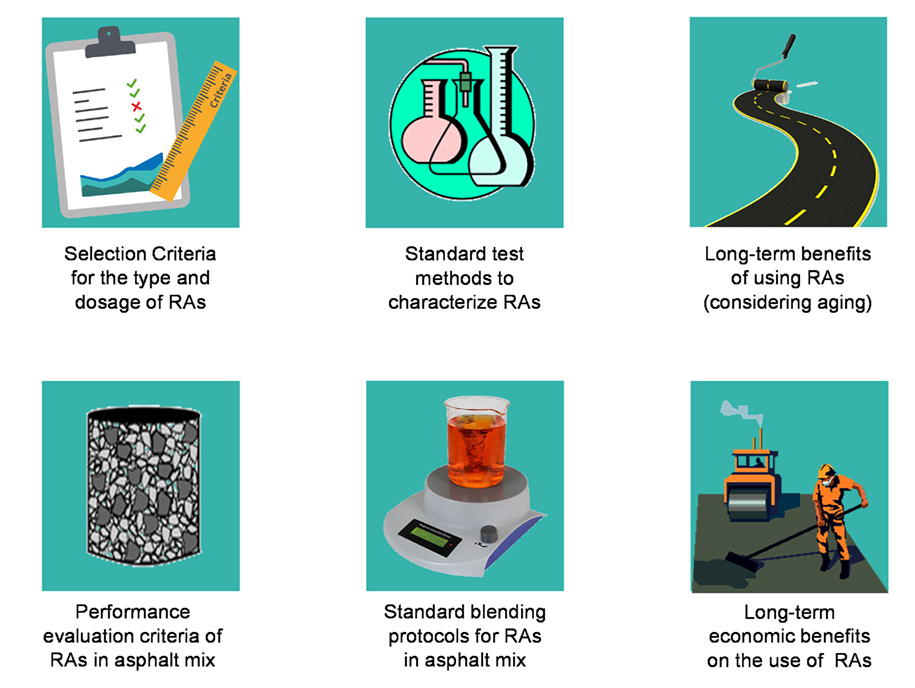
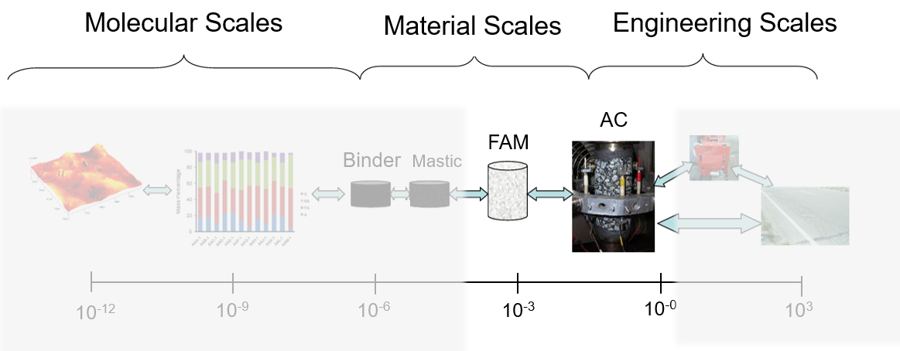
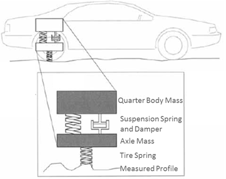

---
title: "Research Overview"
format: html
---

Welcome to my research website!

My research seeks to advance our understanding of pavement structures and material behavior and translate this scientific knowledge into improved approaches for the design, evaluation, and management of pavement infrastructure. This vision is guided by three interconnected principles:

1. Understanding the physical mechanisms governing pavement material behavior.
2. Examining pavement infrastructure from a systems perspective, recognizing the interactions among materials, structures, loading, and the environment.
3. Translating fundamental understanding into practical engineering decisions.

To pursue this vision, my research combines experimental investigations, mechanistic and computational modeling, and statistical methods to examine pavement behavior across different length scales and under varying environmental conditions. Some of my research areas include:

THIS IS STILL UNDER CONSTRUCTION - PRELIMINARY VERSION

## Sustainable Asphalt Materials

::: {.research-section}

::: {.research-image-left}

{width="100%"}

:::

The increasing use of recycled materials in asphalt mixtures presents both opportunities and challenges for pavement sustainability. During my doctoral studies at North Carolina State University, I investigated how recycling agents (RAs) can restore the properties of aged asphalt binders and improve the performance of mixtures containing reclaimed asphalt pavement (RAP). Much of this work focused on understanding what makes an RA effective and how its effectiveness can be evaluated through performance-based criteria. My investigations covered both binder rheology and mixture performance, including the development of approaches for evaluating RA effectiveness and incorporating RAs into balanced mix design (BMD). The findings contributed to two performance-based frameworks developed to support the Virginia Department of Transportation's efforts to increase the responsible use of recycled asphalt materials. 

[Learn more →](sustainable-materials.qmd)

:::

---

## Multiscale Mechanics

::: {.research-section}

Understanding how asphalt mixtures behave requires looking beyond their overall performance and examining the interactions among their constituents. This question became particularly interesting to me when studying recycled asphalt mixtures, whose microstructure can be considerably more complex than that of conventional mixtures. My doctoral research explored the use of fine aggregate matrix (FAM) as an intermediate material scale to investigate viscoelastic behavior and fatigue damage. I developed a FAM mixture design methodology that accounts for the microstructural characteristics of recycled mixtures and applied viscoelastic continuum damage (VECD) theory to characterize FAM damage behavior. I also developed a multiscale modeling framework combining composite mechanics, linear viscoelasticity, and VECD theory to establish a mechanistic connection between FAM and mixture behavior. This area remains closely connected to my interest in understanding material behavior through mechanics and developing predictive models across different length scales.

{width="100%"}

[Learn more →](multiscale-mechanics.qmd)

:::

---

## Environmental Effects on Pavement Structural Behavior and Performance 

::: {.research-section}

::: {.research-image-left}

{width="100%"}

:::

Pavement structures are constantly exposed to changing environmental conditions, yet accounting for these effects in pavement evaluation and design is not always straightforward. At Applied Research Associates (ARA), I have had the opportunity to investigate these challenges through research sponsored by the Florida Department of Transportation (FDOT). One project examines how seasonal variations in temperature and moisture affect subgrade stiffness and how these variations can be incorporated into existing rehabilitation design procedures. Another focuses on assessing pavement structural capacity following flooding to support decisions about reopening roadways to traffic. Both studies involve falling weight deflectometer (FWD) measurements, environmental data, and mechanistic and statistical modeling. A common interest behind these efforts is understanding how environmental conditions influence pavement structural behavior and how this knowledge can inform practical engineering decisions.

[Learn more →](environmental-effects.qmd)

:::

---

## Functional Pavement Performance

::: {.research-section}

::: {.research-image-left}

{width="100%"}

:::

Surface characteristics such as smoothness, friction, and texture also influence the experience and safety of road users. My work in this area includes a research project sponsored by the South Carolina Department of Transportation (SCDOT), where I investigated the relationship between pavement rideability specifications, long-term pavement performance, and life-cycle costs. The study involved the analysis of historical International Roughness Index (IRI) measurements, pavement deterioration modeling, and economic evaluations to examine the implications of construction smoothness requirements. The findings provided a quantitative basis for evaluating and refining pavement rideability specifications. Beyond smoothness, I am also interested in pavement friction and macrotexture, particularly their relationship with traffic safety and their potential incorporation into performance-based specifications and pavement management practices.

[Learn more →](functional-performance.qmd)

:::

---

## Advancing Mechanistic-Empirical Airfield Pavement Design

::: {.research-section}

::: {.research-image-right}

{width="100%"}

:::

More recently, my research has expanded into airfield pavement engineering, where heavy aircraft loads and complex landing gear configurations create challenges that differ from those encountered in roadway pavements. At ARA, I am contributing to research sponsored by the U.S. Army Engineer Research and Development Center (ERDC) to modernize the Department of Defense's pavement design and evaluation methodologies through the Joint Evaluation and Design Integrated (JEDI) software platform. An important part of my role involves integrating advanced pavement response models with mechanistic-empirical performance predictions, including fatigue damage and permanent deformation. I am also leading efforts to incorporate climatic effects into the analysis of pavement material properties and long-term performance. This work has allowed me to expand my experience in pavement mechanics, computational modeling, and performance-based design while exploring their application to airfield infrastructure.

[Learn more →](airfield-design.qmd)

:::

---
